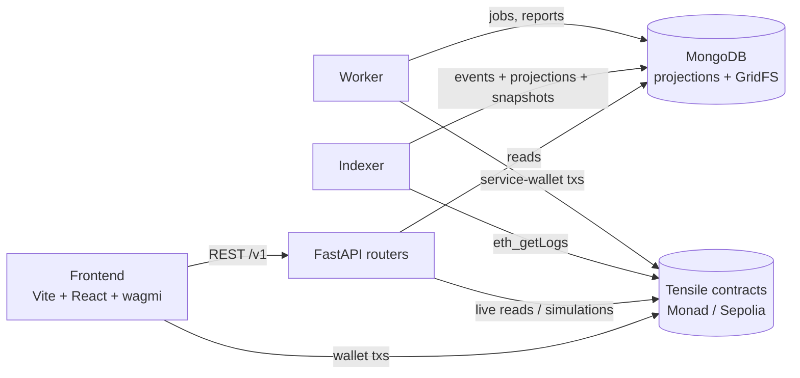

# Tensile backend

API, chain indexer and transaction worker for **Tensile**: tokenized physical metal. Warehouse-held lots become
on-chain *material passports* (ERC-721) that can be borrowed against (Morpho), traded and redeemed for the metal.

- **FastAPI** (async throughout), **MongoDB** (async PyMongo, GridFS for files), **web3.py** (async).
- **Multi-chain**: every chain in `deployments/` is served side by side (Monad testnet `10143`, Sepolia `11155111`).
- **One process can run everything**: the API, the indexer and the worker. Leases in Mongo make it safe to run
  several copies; for each chain, one indexes and one sends transactions, and the rest stand by.

> **Build status.** Stages 1–4 are built and tested. Stages 5–8 are planned; their sections below describe what
> they will add and are marked **planned**. Planned route names may change when the stage is built.

| Stage | Scope | Status |
|---|---|---|
| 1 | Foundation: settings, chain registry, Mongo, Sign-In With Ethereum, `/me`, health | Built |
| 2 | Indexer, worker, protocol data: warehouses, prices, reserve feeds, stats, sync | Built |
| 3 | KYC onboarding, lots and passports, portfolio, activity, notifications, search, ops queue | Built |
| 4 | Tokenize (mint drafts, evidence, automated review, custody, mint) and inspections | Built |
| 5 | Credit: borrow against lots, lend USDC to the vault, testnet faucet | Planned |
| 6 | Marketplace: listings, purchase, RFQ (bids), price index, portfolio view | Planned |
| 7 | Redemption, disputes, reserve health | Planned |
| 8 | Liquidation and risk parameters, contract error map, hardening, deploy | Planned |

---

## Contents

1. [Architecture](#architecture)
2. [Quick start](#quick-start)
3. [Configuration](#configuration)
4. [Chains, deployments and the catalog](#chains-deployments-and-the-catalog)
5. [Scripts](#scripts)
6. [Running: one process or three](#running-one-process-or-three)
7. [API reference](#api-reference)
8. [Domain flows](#domain-flows)
9. [Data model (Mongo)](#data-model-mongo)
10. [Indexer](#indexer)
11. [Worker](#worker)
12. [Deploying to Heroku](#deploying-to-heroku)
13. [Code conventions](#code-conventions)
14. [Troubleshooting](#troubleshooting)

---

## Architecture



- **Users sign their own transactions** in the browser (request a mint, attest an inspection, borrow, buy…). The
  API never holds user keys. It prepares arguments, simulates calls, and serves what the indexer has recorded.
- **The indexer** copies every Tensile contract log into `events`, applies projections (lots, mint requests, roles,
  identities, attestations), and snapshots small enumerable state (warehouses, prices, the vault) every few seconds.
- **The worker** sends the protocol's own transactions from the **service wallet**. These cover reserve reports
  (co-signed by two signer keys), price heartbeats, KYC identity writes, automated mint reviews, custody
  confirmations for warehouses the service wallet operates, and expiry of stale requests.
- **The API reads Mongo first.** It reads the chain only for live checks: role checks (cached 60 s), `finalizeMint`
  simulation, reserve coverage and allowances.

```
backend/
├── app/
│   ├── main.py                 FastAPI app; starts the indexer/worker in-process when enabled
│   ├── abis/                   contract ABIs (generated by scripts/export_abis.py)
│   ├── bytecode/               bytecode used by the seed script (generated)
│   ├── core/
│   │   ├── config.py           Settings (env / .env)
│   │   ├── schemas.py          every Pydantic model (requests and responses)
│   │   ├── chains.py           chain registry, async web3 per chain, retries
│   │   ├── db.py               Mongo client and indexes
│   │   ├── deps.py             FastAPI dependencies (Chain, Db, User, CatalogDep…)
│   │   ├── security.py         JWT sessions
│   │   ├── authz.py            on-chain role checks (cached), staff dependencies
│   │   ├── roles.py            role hashes, personas
│   │   ├── catalog.py          catalog.json: materials, warehouses, defaults
│   │   ├── present.py          Book: per-request lookup tables and display helpers
│   │   ├── activity.py         event → activity item descriptions
│   │   ├── evidence.py         GridFS files, canonical JSON, dataHash / certHash, tensile:// URIs
│   │   ├── minting.py          tokenize: doc kinds, step builder, controller params, certificate claims
│   │   ├── reports.py          review / inspection / custody presenters
│   │   ├── jobs.py             Mongo job queue (dedupe, retries with back-off)
│   │   ├── leases.py           leader leases (one indexer / one worker per chain)
│   │   ├── txsender.py         service-wallet sender (nonces, fees, receipts, revert decoding)
│   │   ├── evm.py              conversions (ints, bytes32 text, timestamps)
│   │   ├── errors.py           ApiError and the {"error": {...}} shape
│   │   └── process.py          shared start-up for the standalone processes
│   ├── indexer/                logs.py, handlers.py (projections), snapshots.py, service.py
│   ├── worker/                 service.py (loop + jobs), upkeep.py, minting.py (mint keeper)
│   └── routers/                auth, chains, health, me, protocol, kyc, lots, portfolio, search,
│                               ops, tokenize, inspections   (+ credit, market, redemption, risk: planned)
├── deployments/<chainId>.json  contract addresses per chain (from the deploy script)
├── chains.json                 chain metadata: name, RPC, explorer, deploy block, log range
├── catalog.json                materials, warehouses, protocol defaults
├── scripts/                    seed, ABI export, signer keys, dev login
├── requirements.txt
├── Procfile
└── .env.example
```

---

## Quick start

Requirements: **Python 3.11+**, **MongoDB 6+** (local, Docker or Atlas; GridFS is used for files), RPC access to
the chains in `deployments/`, and the contracts already deployed (see `contracts/`).

```bash
cd backend
python -m venv .venv
source .venv/bin/activate          # Windows: .venv\Scripts\activate
pip install -r requirements.txt

cp .env.example .env               # then fill it in (see Configuration)
python -c "import secrets; print(secrets.token_urlsafe(48))"   # → JWT_SECRET

# ABIs from the Foundry build (contracts/out). This also writes the frontend's src/abis.
python scripts/export_abis.py

# One-off: signer keys for reserve reports, then align the chain with catalog.json and .env
python scripts/gen_signer_keys.py
python scripts/seed.py
python scripts/seed.py --check     # read-only report of what is (and isn't) set up

uvicorn app.main:app --reload --port 8000
```

- Open `http://localhost:8000/v1/health`, `/v1/chains` and `/docs` (Swagger) to check it's up.
- With `RUN_INDEXER=true` and `RUN_WORKER=true` in `.env`, the same process indexes and sends upkeep transactions.
- Every script takes `-h` for its options.

---

## Configuration

All settings come from environment variables, or from `backend/.env` locally. Names are case-insensitive. Lists and
dicts are JSON.

| Variable | Default | What it does |
|---|---|---|
| `ENV` | `dev` | Free-form environment name |
| `API_PREFIX` | `/v1` | Prefix for every route |
| `MONGO_URI` | `mongodb://localhost:27017` | Mongo connection string (Atlas: `mongodb+srv://…`) |
| `MONGO_DB` | `tensile` | Database name |
| `MONGO_MAX_POOL_SIZE` | `100` | Connection pool size |
| `JWT_SECRET` | **required** | 32+ characters; signs session tokens |
| `JWT_TTL_MINUTES` | `720` | Session length |
| `SIWE_DOMAINS` | `["localhost:5173"]` | Hosts the frontend is served from: `host[:port]`, **no scheme, no path**. Patterns allowed (`localhost:*`, `tensile-fe-*.herokuapp.com`) |
| `SIWE_NONCE_TTL_SECONDS` | `600` | Sign-in nonce lifetime |
| `DEPLOYMENTS_DIR` | `backend/deployments` | Folder of `<chainId>.json` address files |
| `CHAINS_FILE` | `backend/chains.json` | Chain metadata |
| `CATALOG_FILE` | `backend/catalog.json` | Materials, warehouses, defaults |
| `ABIS_DIR` / `BYTECODE_DIR` | `app/abis`, `app/bytecode` | Generated by `export_abis.py` |
| `RPC_URLS` | `{}` | Private RPC per chain, e.g. `{"10143":"https://…"}`; overrides `chains.json` for the backend only |
| `RPC_TIMEOUT_SECONDS` | `8` | Per-call timeout |
| `DEFAULT_CHAIN_ID` | first deployment | Chain the frontend opens on |
| `DEPLOYER_PRIVATE_KEY` | — | ADMIN on every chain; runs the seed. Also the service wallet if `SERVICE_PRIVATE_KEY` is unset |
| `SERVICE_PRIVATE_KEY` | deployer key | The worker's sending wallet (needs gas on every chain) |
| `RESERVE_SIGNER_A_KEY` / `RESERVE_SIGNER_B_KEY` | — | Warehouse-side and inspector-side reserve report signers. They sign only and need no gas |
| `STAFF_WALLETS` | `[]` | Seed grants ADMIN, KYC_ADMIN, RISK_ADMIN, INSPECTOR and KYC to these |
| `KYC_WALLETS` | `[]` | Seed grants KYC only (demo users) |
| `RUN_INDEXER` | `false` | Run the indexer inside the API process |
| `RUN_WORKER` | `false` | Run the worker inside the API process |
| `INDEXER_POLL_SECONDS` | `2` | Poll interval once caught up |
| `INDEXER_PARALLEL_RANGES` | `4` | `eth_getLogs` calls in flight while catching up |
| `SNAPSHOT_SECONDS` | `30` | Warehouse / price / vault re-read interval |
| `UPKEEP_SECONDS` | `300` | How often the worker checks reserve reports and prices |
| `RESERVE_REFRESH_HOURS` | `12` | Re-submit a reserve report older than this (on-chain limit: 24 h) |
| `PRICE_REFRESH_HOURS` | `24` | Heartbeat a price older than this (adapter limit: 3 days) |
| `LOW_GAS_NATIVE` | `0.05` | Warn when the service wallet holds less than this native balance |
| `MINT_KEEPER_SECONDS` | `10` | How often open mint requests are checked (review, custody, expiry) |
| `AUTO_CUSTODY` | `true` | Confirm custody after inspection for warehouses the service wallet operates |

**Secrets.** Never commit `.env`. On Heroku, set these as config vars. The API itself only needs the keys when the
worker runs in-process.

---

## Chains, deployments and the catalog

**`deployments/<chainId>.json`**: written by the contracts' deploy script. Keys look like
`C08_MintingController`. The `C08_` prefix is stripped, so code refers to contracts by name
(`chain.contract("MintingController")`). One file per chain; dropping a file in adds the chain.

**`chains.json`**: metadata for each chain id: `name`, `shortName`, `testnet`, `nativeCurrency`, public `rpcUrl`,
`explorerUrl`, `deployBlock` (where indexing starts), `logsBlockRange` (max blocks per `eth_getLogs`),
`confirmations` (how far the indexer stays behind head) and `enabled`. The public RPC URL is sent to the frontend.
Private RPCs go in `RPC_URLS`.

**`catalog.json`**: off-chain reference data the contracts don't store:
- `materials`: code (e.g. `CU-CATH-A`), name, symbol, family, grade. On-chain `materialCode = keccak256(code)`.
- `warehouses`: code, name, operator name, country, place, coordinates, stored materials, starting reserve. The
  on-chain warehouse's `metaURI` points at its code.
- `prices`: the (material, region) pairs that have price feeds.
- `classDefaults` (e.g. `routerMaxLtvBps`, `maxAttestationAgeDays`) and `identityDefaults` (`tier`, `validDays`).

**Multi-chain.** Every chain route is `/v1/chains/{chainId}/…`, and the frontend's chain switcher picks the id.
KYC is chain-independent: one application, and an approval writes the identity to every chain.

---

## Scripts

Run from `backend/` with the virtualenv active. Every script takes `-h`.

| Script | What it does |
|---|---|
| `scripts/export_abis.py` | Reads the Foundry build output and writes `app/abis/*.json`, `app/bytecode/` and the frontend's `src/abis/*.ts` (typed `as const`). Run it again after any contract change. |
| `scripts/gen_signer_keys.py` | Generates `RESERVE_SIGNER_A_KEY` / `RESERVE_SIGNER_B_KEY` for `.env`. |
| `scripts/seed.py` | Aligns each chain with `catalog.json` and `.env`. It grants staff and KYC roles, gives the service wallet AI_AGENT / PRICE_UPDATER and warehouse operator, sets reserve-feed signers, and sets initial prices. Idempotent. `--check` reports without sending. |
| `scripts/dev_login.py` | Signs in from the command line with a local key and prints a bearer token, for `curl` / Swagger testing. |

> Don't run `seed.py` while a worker is running: they send from the same wallet and will race on nonces.

---

## Running: one process or three

**One process** (recommended; this is what Heroku runs):

```bash
RUN_INDEXER=true RUN_WORKER=true uvicorn app.main:app --port 8000
```

**Separate processes** (for scaling the API on its own):

```bash
uvicorn app.main:app --port 8000          # API only (RUN_INDEXER / RUN_WORKER false)
python -m app.indexer                     # all chains; --chain 10143 (repeatable)
python -m app.worker                      # all chains; --chain 10143; --once = one upkeep pass then exit
python -m app.indexer --rebuild           # stop the indexer first: replay stored events into projections
```

Leases (`leases` collection, 45 s TTL with keepalive) give one leader per chain for each of the indexer and the
worker. Extra copies wait on standby and take over within about a minute if the leader dies. API instances scale
freely: they are stateless and every route is `async`.

---

## API reference

Base path `/v1`. JSON is **camelCase** on the wire. Errors always look like
`{"error": {"code": "certificate_in_use", "message": "…", "details": …}}`.

**Auth.** Sign-In With Ethereum (EIP-4361) gives a JWT, sent as `Authorization: Bearer <token>`.
- **Public**: no token needed.
- **User**: any signed-in wallet.
- **Staff**: an on-chain role on that chain (checked live, cached 60 s).

### Foundation (Stage 1)

| Method | Path | Auth | Description |
|---|---|---|---|
| GET | `/health` | Public | Mongo and per-chain RPC status |
| GET | `/chains` | Public | Chains (name, public RPC, explorer, contract addresses) and the default chain |
| POST | `/auth/nonce` | Public | `{address}` → one-time nonce for the sign-in message |
| POST | `/auth/verify` | Public | `{message, signature}` → `{token, expiresAt, address}` |
| GET | `/auth/session` | User | Who the token belongs to |
| GET | `/chains/{id}/me` | User | Roles, personas (owner, lender, buyer, inspector, ops) and identity on this chain |

### Protocol data (Stage 2)

| Method | Path | Auth | Description |
|---|---|---|---|
| GET | `/chains/{id}/warehouses` | Public | Every warehouse: catalog details, reserve, outstanding, coverage, health, frozen reason |
| GET | `/chains/{id}/warehouses/{warehouseId}` | Public | One warehouse |
| GET | `/chains/{id}/prices` | Public | Price per (material, region), haircut, staleness |
| GET | `/chains/{id}/prices/{material}/{region}/history` | Public | Price rounds |
| GET | `/chains/{id}/protocol/stats` | Public | Custody, tokenized kg, lots, value, vault totals |
| GET | `/chains/{id}/sync` | Public | Indexer and worker liveness, lag, last upkeep, low gas |

### Identity, lots, portfolio, search, ops (Stage 3)

| Method | Path | Auth | Description |
|---|---|---|---|
| GET / PUT | `/kyc/me` | User | Your application (organisation, country, entity type, tier) |
| POST | `/kyc/me/documents` | User | Upload a document (`kind`: registration, owners, directors) |
| DELETE | `/kyc/me/documents/{docId}` | User | Remove a document |
| POST | `/kyc/me/submit` | User | Submit for review (runs screening) |
| GET | `/kyc/documents/{docId}` | User / KYC_ADMIN | Download a document |
| GET | `/kyc/applications` | KYC_ADMIN | Review queue |
| GET | `/kyc/applications/{address}` | KYC_ADMIN | One application |
| POST | `/kyc/applications/{address}/approve` | KYC_ADMIN | Approve; queues an identity write on every chain |
| POST | `/kyc/applications/{address}/reject` | KYC_ADMIN | Reject with a reason |
| GET | `/chains/{id}/lots` | Public | Lots (filter by owner, state, warehouse, material) |
| GET | `/chains/{id}/lots/{tokenId}` | Public | Passport: lot, warehouse, mint request, attestations, history |
| GET | `/chains/{id}/portfolio` | User | Holdings, value history, sites, borrow capacity |
| GET | `/chains/{id}/activity` | Public / User | `scope=all` (public) or `scope=mine` |
| GET | `/chains/{id}/notifications` | User | Activity touching you, with an unread count |
| POST | `/chains/{id}/notifications/seen` | User | Mark read |
| GET | `/chains/{id}/search?q=` | Public | Lots, mint requests (MR-…), warehouses, materials, addresses |
| GET | `/chains/{id}/ops/queue` | Staff | Operations console work queue across modules |

### Tokenize and inspections (Stage 4)

| Method | Path | Auth | Description |
|---|---|---|---|
| GET | `/chains/{id}/mint/config` | Public | Controller params (min review score, TTL, fee), materials, eligible warehouses, document kinds |
| GET / POST | `/chains/{id}/mint/drafts` | User | Your open drafts / create a draft (material, warehouse, quantity, certificate id, receipt no.) |
| GET / PUT / DELETE | `/chains/{id}/mint/drafts/{draftId}` | User (owner) | Read / edit / discard a draft |
| POST | `/chains/{id}/mint/drafts/{draftId}/documents` | User (owner) | Upload evidence (`kind`: certificate, receipt, weighbridge, photos, mill) |
| DELETE | `/chains/{id}/mint/drafts/{draftId}/documents/{fileId}` | User (owner) | Remove evidence |
| POST | `/chains/{id}/mint/drafts/{draftId}/prepare` | User (owner) | Freeze the evidence and return the `requestMint` arguments (plus whether a fee approval is needed) |
| POST | `/chains/{id}/mint/drafts/{draftId}/reopen` | User (owner) | Back to editing after the wallet refused or the tx failed |
| GET | `/chains/{id}/mint/requests` | User / Staff | `scope=mine` or `scope=all` (staff), `state=open,closed,all` |
| GET | `/chains/{id}/mint/requests/{requestId}` | Owner / Staff | Seven steps, review, inspection, custody, reserve check, allowed actions, history |
| GET | `/chains/{id}/evidence/files/{fileId}` | Owner / Staff | Download an evidence or inspection file |
| GET | `/evidence/{draftId}` | Public | Resolves `tensile://evidence/<id>`: the file manifest with SHA-256s |
| GET | `/reports/{reportId}` | Public | Resolves `tensile://reports/<id>`: the body behind an attestation and whether it hashes to its `dataHash` |
| GET / PUT | `/chains/{id}/inspectors/me` | User / INSPECTOR | Inspector profile (name, organisation, licence) |
| GET | `/chains/{id}/inspections/queue` | INSPECTOR, RISK_ADMIN, ADMIN | Open mint requests, reinspection orders, lots due for re-attestation |
| POST | `/chains/{id}/inspections/files` | INSPECTOR | Upload a file for a report (`kind`: weigh, photos, assay, report) |
| POST | `/chains/{id}/inspections/reports` | INSPECTOR | Seal a report; returns `dataHash`, `uri` and what to sign |
| GET | `/chains/{id}/inspections/reports/{reportId}` | Inspector / Owner / Staff | One report |
| GET | `/chains/{id}/inspections/history` | INSPECTOR, RISK_ADMIN, ADMIN | Attested and failed inspections |
| GET / POST | `/chains/{id}/inspections/orders` | Staff / RISK_ADMIN, ADMIN | List / order a lot reinspection |
| DELETE | `/chains/{id}/inspections/orders/{orderId}` | RISK_ADMIN, ADMIN | Cancel an order |

### Credit (Stage 5, planned)

Contracts: `CreditRouter`, `TensileCreditVault` (ERC-4626 over USDC), `MarketRegistry` (one Morpho market per
material class and warehouse), `LotWrapper`, `TensileMorphoOracle`, `PriceOracleAdapter`, USDC (`MockUSDC` on
testnets).

- **Borrow (user signs):** a quote for a lot (collateral value after haircut, max LTV, rate, liquidation price).
  Then `openLoan(tokenId, amount)`, `borrowMore`, `repay` and `closeLoan`. Loans are indexed from
  `LoanOpened/Borrowed/Repaid/LoanClosed`.
- **Lend (user signs):** vault position, APY, utilization and class caps. Then `deposit` / `withdraw` / `redeem`
  on the vault.
- **Faucet (testnets):** `MockUSDC.faucet`, through the worker or directly.
- **Planned routes:** `/chains/{id}/credit/{quote,loans,loans/{tokenId}}` and `/chains/{id}/vault{,/me}`.

### Marketplace (Stage 6, planned)

Contracts: `Marketplace`, `PriceIndex`, `FeeCollector`, `CreditRouter.payoffFor` (a sale pays off the lot's loan
atomically).

- **Listings:** `list(tokenId, price, payToken, expiry)`, `buy`, `cancelListing`. Indexed as `Listed / Settled /
  ListingCancelled`.
- **RFQ (bids):** `placeBid(tokenId, price, expiry)`, `acceptBid`, `cancelBid`.
- **Price index:** trades recorded in `PriceIndex` feed reference prices per material and region.
- **Planned routes:** `/chains/{id}/market/{listings,listings/{id},bids,trades}` and a purchase preview (fees,
  payoff, net to seller).

### Redemption, disputes, reserve health (Stage 7, planned)

Contracts: `RedemptionManager`, `WarehouseRegistry`, `TensileReserveFeed`, `ReserveGuard`.

- **Redemption:** `requestRedemption(tokenId, deliveryRef)` locks the lot (REDEEMING). The operator confirms with
  `confirmRelease(id, dataHash, uri)`, which burns the passport. The owner can `cancelRedemption`, or
  `raiseDispute` once the release SLA has passed.
- **Disputes:** the operations workflow with reinspection orders (built in Stage 4) and freeze / unfreeze.
- **Reserve health:** feed history, coverage per warehouse, breaches (`ReserveBreach`) and frozen warehouses.
- **Planned routes:** `/chains/{id}/redemptions…`, `/chains/{id}/disputes…`, `/chains/{id}/reserve…`.

### Liquidation and risk (Stage 8, planned)

- Positions near the liquidation LTV, from Morpho market state and oracle prices, and liquidation history.
- Class parameters through `MarketRegistry.proposeClass / approveClass` (two-step), shown and edited in the
  operations console.
- A contract-error map (custom error → message) shared with the frontend, plus final hardening and deploy.

---

## Domain flows

### Sign-in

1. The frontend asks `/auth/nonce` with the wallet address.
2. The wallet signs an EIP-4361 message whose domain is the page host. That host must match `SIWE_DOMAINS`.
3. `/auth/verify` checks the signature and the single-use nonce and returns a JWT.

Roles are never in the token. They are read on-chain per request (cached), so revoking a role takes effect within a
minute.

### KYC

1. The applicant fills the form and uploads documents (GridFS bucket `kyc_docs`), then submits.
2. A KYC_ADMIN approves. A `kyc.set_identity` job is queued per chain, and the worker calls
   `IdentityRegistry.setIdentity(account, country, tier, expiry)` everywhere.

### Tokenize (F-1), seven steps

1. **Details** and 2. **Evidence**: an off-chain *draft*. Files live in GridFS bucket `evidence`; each file's
   SHA-256 is recorded.
2. `prepare` freezes the draft. `certHash = keccak256("tensile:certificate:" + normalised certificate id)` and the
   evidence URI is `tensile://evidence/<draftId>`. The **owner signs** `MintingController.requestMint(…)`. The
   indexer records `MintRequested`, and the draft links to the request id.
3. **Automated review**: the worker's mint keeper scores the evidence with 7 rule-based checks out of 100 (PDF
   text via pypdf), stores the report and attests `AI_REVIEW` with the score. Below `minAiScore` (70), a
   RISK_ADMIN can `overrideAi` or `rejectRequest`.
4. **Inspection**: an INSPECTOR seals a report through the API and **signs**
   `AttestationRegistry.attest(INSPECTION, REQUEST, id, 0, dataHash, uri)`. A failed inspection signs
   `rejectRequest(id, "INSPECTION_FAILED")` instead.
5. **Custody**: for warehouses operated by the service wallet, the worker calls `confirmCustody` after
   inspection (`AUTO_CUSTODY`).
6. **Reserve**: `ReserveGuard.canAdd(warehouse, kg)` must hold. The warehouse's attested reserve has to cover
   outstanding plus this lot.
7. **Mint**: the **owner signs** `finalizeMint(id)`. The API simulates it first and reports the blocking contract
   error, if any. The passport is minted with state FREE.

Requests expire after `requestTTL` (14 days). The keeper closes them with `expireRequest`. A cancelled, rejected
or expired request frees its certificate.

### Reports and verifiability

Every attestation's `dataHash` is the keccak256 of a canonical JSON report (sorted keys, no whitespace, ISO
times). `uri = tensile://reports/<id>`. Anyone can `GET /v1/reports/<id>` and check `verified: true`.

### Reinspection

- Lots whose last attestation nears `maxAttestationAgeDays` appear in the inspection queue as DUE, then OVERDUE.
- RISK_ADMIN can order a reinspection. It closes when a `REINSPECTION` attestation for the lot lands.

---

## Data model (Mongo)

| Collection | Written by | Holds |
|---|---|---|
| `events` | indexer | Every decoded Tensile log (`chainId, blockNumber, logIndex, contract, event, args, txHash, timestamp`) |
| `lots` | indexer | Passport projection: owner, material, warehouse, kg, state, attestation times |
| `mint_requests` | indexer | Request projection: status, custody, override, token id |
| `attestations` | indexer | Every attestation (kind, subject, attestor, score, dataHash, uri) |
| `roles`, `identities` | indexer | Role grants, on-chain identities |
| `warehouses`, `prices` | snapshots | Latest warehouse state (reserve, coverage, health) and prices |
| `reserve_history`, `price_history` | snapshots | Feed rounds |
| `chain_status` | indexer / worker | Checkpoints, liveness, errors, service-wallet balance |
| `auth_nonces`, `users` | API | Sign-in nonces (TTL index) and last logins |
| `kyc_applications` | API | Applications, document refs, review state |
| `mint_drafts` | API | Drafts and their evidence refs |
| `reports` | API / worker | Report bodies behind attestations (review, inspection, custody) |
| `inspectors`, `reinspection_orders`, `counters` | API | Inspector profiles, orders, sequence numbers |
| `jobs` | API / worker | Queue: kind, payload, status, attempts, back-off, dedupe key (finished jobs expire after 14 days) |
| `leases` | indexer / worker | Leader leases per chain |
| `kyc_docs.*`, `evidence.*` | API | GridFS buckets (files up to 25 MB, PDF / PNG / JPEG sniffed by content) |

Indexes are created at start-up (`app/core/db.py`). TTL and partial indexes need real MongoDB.

---

## Indexer

- **Checkpoint:** `chain_status.logs.block`. It only advances after a range is stored and applied. Ranges are
  fetched in parallel while catching up but applied in block order. The indexer stays `confirmations` blocks
  behind head.
- **Handlers** (`indexer/handlers.py`) are idempotent upserts keyed by chain and id. `--rebuild` replays `events`
  into the projections.
- **Snapshots** re-read warehouses (registry plus guard plus passport outstanding), prices (adapter plus feeds)
  and the vault every `SNAPSHOT_SECONDS`, and back-fill feed rounds into the history collections.
- A missing ABI or an undeployed contract only skips that contract, with a warning in the log.

---

## Worker

- **TxSender:** one sender per chain from the service wallet. It keeps a local nonce, resets it on any failure,
  sets EIP-1559 fees, waits for receipts and decodes reverts to custom-error names.
- **Upkeep** (every `UPKEEP_SECONDS`): re-submits reserve reports older than `RESERVE_REFRESH_HOURS`, co-signed
  by signers A and B. It also sends price heartbeats older than `PRICE_REFRESH_HOURS` and records the service
  wallet's balance.
- **Mint keeper** (every `MINT_KEEPER_SECONDS`): links submitted drafts, queues `mint.review`, `mint.custody`
  and `mint.expire`.
- **Jobs:** `upkeep`, `reserve.report`, `kyc.set_identity`, `mint.review`, `mint.custody`, `mint.expire`.
  - Retries back off at 15 s × 2ⁿ, capped at 10 min.
  - A mint job that runs out of attempts is re-queued by the keeper 30 minutes later.
  - Handlers re-read the chain first, so duplicates do nothing twice.
- **Planned (Stages 5–8):** faucet drips, loan accrual and health checks, listing expiry, redemption SLA timers,
  and liquidation alerts.

---

## Deploying to Heroku

One **Basic** dyno runs everything:

```
Procfile:  web: uvicorn app.main:app --host 0.0.0.0 --port $PORT
```

```bash
heroku create tensile-api
heroku config:set \
  MONGO_URI='mongodb+srv://…' MONGO_DB=tensile JWT_SECRET='…' \
  SIWE_DOMAINS='["localhost:*","127.0.0.1:*","tensile-fe-xxxx.herokuapp.com"]' \
  RUN_INDEXER=true RUN_WORKER=true \
  DEPLOYER_PRIVATE_KEY=0x… RESERVE_SIGNER_A_KEY=0x… RESERVE_SIGNER_B_KEY=0x… \
  RPC_URLS='{"10143":"https://…","11155111":"https://…"}'
git subtree push --prefix backend heroku main      # or deploy backend/ however you prefer
```

- `deployments/`, `chains.json`, `catalog.json` and `app/abis/` must be committed: they ship with the slug.
- Mongo Atlas: allow Heroku's egress (or `0.0.0.0/0` with a strong password).
- Keep the service wallet funded on every chain. `/v1/chains/{id}/sync` reports `lowGas`.
- Basic dynos don't sleep. Eco dynos do, which pauses the indexer and worker.

---

## Code conventions

- **Every Pydantic model lives in `app/core/schemas.py`.** `ApiModel` gives snake_case in Python and camelCase on
  the wire.
- **Nothing blocks the event loop.** Routes and dependencies are `async`. Chain reads use async web3 with timeouts
  and retries (`with_retries`). CPU-bound work such as PDF text goes through `asyncio.to_thread`.
- **Errors:** raise `ApiError(status, code, message, details?)` and never return error bodies by hand.
- **CORS** allows every origin. Auth is a bearer token, never cookies.
- **Users sign their own transactions.** The API prepares and simulates. The service wallet only does protocol
  upkeep.
- Contract names come from `deployments/` keys without the `Cxx_` prefix. ABIs come from `export_abis.py`, so
  never hand-edit `app/abis/`.

---

## Troubleshooting

| Symptom | Fix |
|---|---|
| `Sign-in domain … is not allowed` | Add the frontend host to `SIWE_DOMAINS`: `host[:port]` only, no `https://`, no path. Restart (on Heroku `config:set` restarts). |
| `abi_missing` errors | Run `python scripts/export_abis.py` after `forge build`. |
| `nonce too low` in worker logs | Something else sent from the service wallet (often `seed.py` while the worker runs). The sender resets and the job retries. |
| Sync badge says "indexer offline" | `RUN_INDEXER` is off, the dyno slept, or the RPC is failing. See `chain_status.logs.error`. |
| Timeouts on public RPCs | Set private endpoints in `RPC_URLS`, or lower `INDEXER_PARALLEL_RANGES` and `logsBlockRange`. |
| Reserve feeds stale / warehouses unhealthy | The worker isn't running, or the reserve signer keys don't match the feeds. Run `seed.py --check`. |
| `certificate_in_use` on prepare | Another open or minted request holds the certificate. Closed requests (cancelled, rejected, expired) free it. |